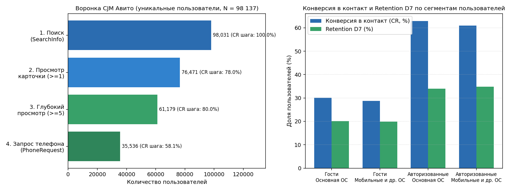

# Воронка CJM и когортный Retention в классифайде (`rel-avito`)

Предобработка сырого кликстрима, построение пошаговой воронки до запроса контакта продавца и расчет когортного удержания на данных *Avito Context Ad Clicks* (`rel-avito`, 25.04.2015 — 20.05.2015).



## Данные и ход работы

Анализируются потоки `SearchInfo` (2.58 млн), `VisitStream` (6.45 млн), `PhoneRequestsStream` (303.0 тыс.), справочник `AdsInfo` (5.96 млн) и профили `UserInfo` (98.2 тыс.):

1. **Очистка логов (`project_2_funnel_retention.sql` / `.py`):**
   - Удаление поисковых событий с пустым `UserID`.
   - Фильтрация бот-активности по `IPID` (отсечение адресов выше 99.95-го перцентиля просмотров карточек).
   - Подавление клиентского дребезга: удаление повторных событий одного `UserID` по одной карточке/категории с интервалом `< 3 сек` через `LAG()`.
2. **Воронка и когорты:**
   - Последовательная 4-этапная воронка: поиск → просмотр карточки (≥ 1) → глубокий просмотр (≥ 5) → запрос телефона продавца.
   - Когортный `Retention D1, D3, D7, D14` по дате первого события пользователя.
   - Сравнение конверсии, удержания и средней цены товара (`AdsInfo.Price`) в разрезе авторизации (`IsUserLoggedOn`) и типа ОС (`UserAgentOSID`).

## Результаты

### 1. Очистка потока событий

| Этап | Событий | Доля |
| :--- | ---: | ---: |
| **Сырой поток (`SearchInfo + VisitStream + PhoneRequests`)** | 9 336 825 | 100.00% |
| — бот-активность (> 99.95% перцентиля `IPID`) | 204 481 | 2.19% |
| — дубликаты кликов (< 3 сек) | 62 492 | 0.67% |
| — записи без `UserID` | 32 713 | 0.35% |
| **Всего отфильтровано** | **299 686** | **3.21%** |
| **Очищенная таблица сессий** | **9 037 139** | **96.79%** |

### 2. Пошаговая воронка (N = 98 031 пользователей)

| Шаг | Пользователи | CR шага | Отвал шага | Сквозной CR |
| :--- | ---: | ---: | ---: | ---: |
| **1. Поисковая сессия (`SearchInfo`)** | 98 031 | 100.00% | 0.00% | 100.00% |
| **2. Просмотр карточки (`VisitStream >= 1`)** | 76 471 | 78.01% | 21.99% | 78.01% |
| **3. Глубокий просмотр (`VisitStream >= 5`)** | 61 179 | 80.00% | 20.00% | 62.41% |
| **4. Запрос телефона (`PhoneRequestsStream`)** | 35 536 | 58.09% | 41.91% | **36.25%** |

### 3. Удержание и сегменты

* **Когортный Retention:** `D1` = **26.05%** | `D3` = **20.77%** | `D7` = **23.89%** | `D14` = **27.14%**
* **Цена объявления при запросе контакта (`AdsInfo.Price`):** средняя — 52 005 руб., медиана — 9 000 руб.

| Сегмент | Пользователи | Сквозной CR | Retention D1 | Retention D7 | Просмотров / польз. | Средняя цена, руб. |
| :--- | ---: | ---: | ---: | ---: | ---: | ---: |
| **Гости \| Основная ОС** | 42 875 | 30.10% | 21.08% | 20.10% | 49.3 | 45 003 |
| **Гости \| Мобильные и др. ОС** | 34 894 | 28.78% | 21.44% | 19.92% | 44.5 | 44 002 |
| **Авторизованные \| Основная ОС** | 12 021 | 62.94% | 44.05% | 34.02% | 131.0 | 48 124 |
| **Авторизованные \| Мобильные и др. ОС** | 8 241 | 60.91% | 44.05% | 34.84% | 123.3 | 45 971 |

## Структура и запуск

* `project_2_funnel_retention.sql` — SQL-запрос очистки кликстрима и сборки витрины (Vertica / PostgreSQL).
* `project_2_funnel_retention.py` — расчет метрик в Python и генерация графиков.
* `funnel_retention_metrics.json` — сводка метрик.
* `funnel_retention_dashboard.png` — график воронки и сегментов.

```bash
pip install -r requirements.txt
python project_2_funnel_retention.py
```
